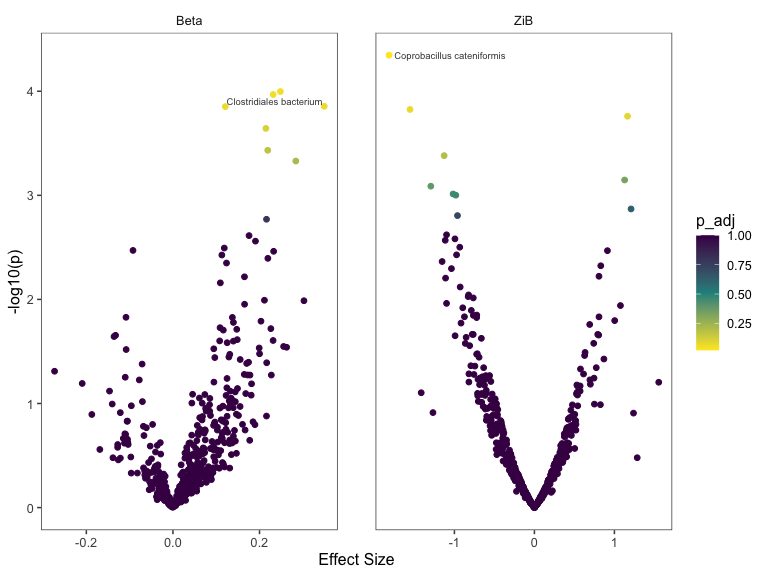
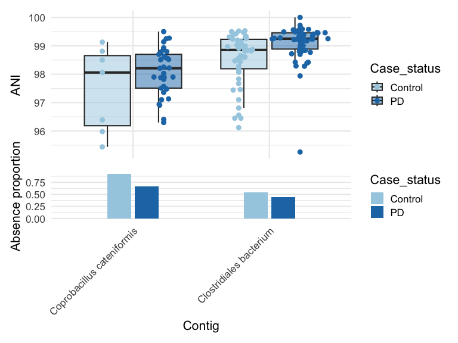
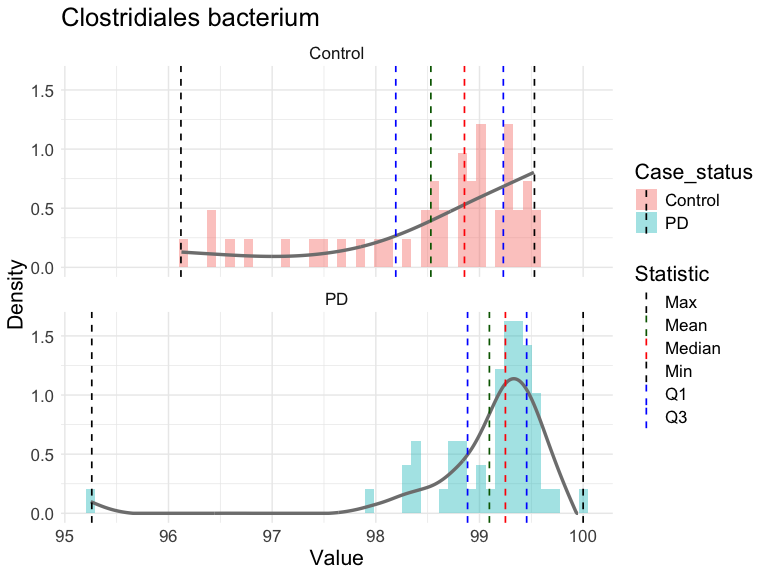
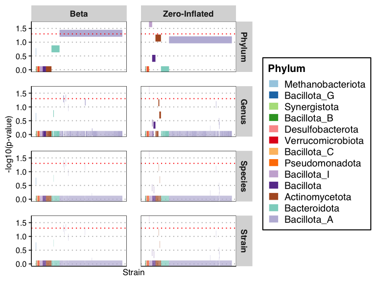
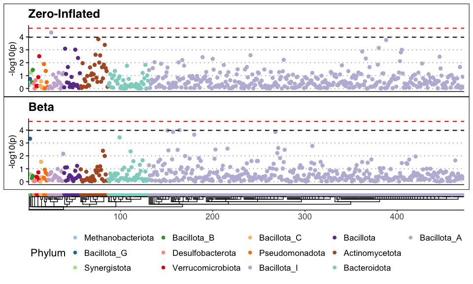
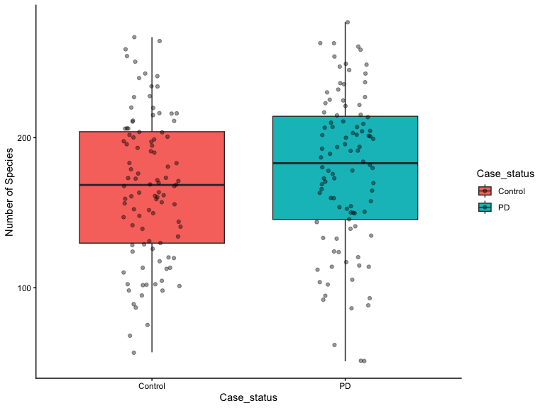
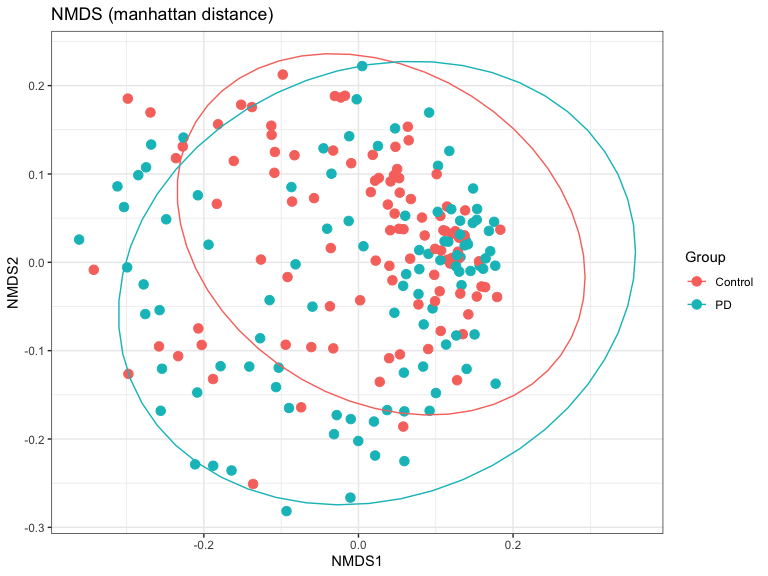

<!-- README.md is generated from README.Rmd. Please only edit the Rmd file -->

# StrainSpy

Strain-level microbiome-wide association studies from metagenomic ANI
profiles.

<!-- badges: start -->

[](https://sudaraka88.r-universe.dev/strainspy)
[](http://bioconda.github.io/recipes/r-strainspy/README.html)
[](http://bioconda.github.io/recipes/r-strainspy/README.html)
[](https://github.com/gtonkinhill/strainspy/actions/workflows/r.yml)
[](https://github.com/gtonkinhill/strainspy/actions/workflows/r-universe.yml)
[](https://opensource.org/licenses/MIT)
[](https://doi.org/10.5281/zenodo.21796878)
[](https://doi.org/10.64898/2026.08.30.748153)
<!-- badges: end -->

## Installation

``` r
install.packages("BiocManager")
install.packages("strainspy", repos = c("https://sudaraka88.r-universe.dev", BiocManager::repositories()))
```

For `conda` and other options, see [alternative installation
options](#alternative-installation-options).

## Quick Start

**NOTE: A guide for using StrainSpy with your own data is provided
[below](#analysing-your-own-data).**

This quick start demonstrates a typical `StrainSpy` analysis and
showcases some of the models and outputs available. Here, we analyse a
200 sample subset of the data described in [Wallen *et al.*
2022](https://doi.org/10.1038/s41467-022-34667-x).

``` r
library(strainspy)
library(ggplot2)

example_meta_path <- system.file("extdata", "example_metadata.csv.gz", package = "strainspy")
example_sylph_path <- system.file("extdata", "example_sylph_profile.tsv.gz", package = "strainspy")
example_taxonomy_path <- system.file("extdata", "example_taxonomy.tsv.gz", package = "strainspy")
```

### Load and filter data

``` r
# Read in metadata
meta_data <- readr::read_csv(example_meta_path)

meta_data$Case_status = factor(meta_data$Case_status)  # Required for visualising
# Read in sylph profile
se <- read_sylph(example_sylph_path, meta_data = meta_data)

# Filter by presence. This will remove any strains that are not present in at
# least 30 samples
se <- filter_by_presence(se, min_nonzero = 30)

# Read in taxonomy
taxonomy <- read_taxonomy(example_taxonomy_path)
```

### Fit the model

``` r
# Create design matrix
design <- as.formula(" ~ Case_status + Age_at_collection")

# Fit a Zero-inflated beta model using the default preset_weak MAP prior
fit <- glmZiBFit(se, design, nthreads = parallel::detectCores(), progress = FALSE)
```

### Summarise and plot the results

``` r
# Get top hits
th = top_hits(fit, coef = 2)

# Create Volcano plot
plot_volcano(fit, label = T)
```



``` r

knitr::kable(th)
```

| Contig_name | Genome_file | coefficient | std_error | p_value | p_adjust | zi_coefficient | zi_std_error | zi_p_value | zi_p_adjust |
|:---|:---|---:|---:|---:|---:|---:|---:|---:|---:|
| NZ_WSNW01000023.1 Coprobacillus cateniformis strain RCA1-24 10234_10235, whole genome shotgun sequence | GCF_009767585.1 | 0.1667314 | 0.1243133 | 0.1798493 | 1.0000000 | -1.8172219 | 0.4454086 | 0.0000451 | 0.0212661 |
| UREB01000001.1 uncultured Clostridiales bacterium isolate UMGS913 genome assembly, contig: NODE_380_length_41473_cov_4.232942, whole genome shotgun sequence | GCA_900546685.1 | 0.2481419 | 0.0638069 | 0.0001007 | 0.0475203 | -0.3495862 | 0.2874739 | 0.2239611 | 1.0000000 |

*Coprobacillus cateniformis* shows difference in presence (adjusted p =
0.0213). *Clostridiales bacterium* shows difference in identity
(adjusted p \< 0.01).

### Perform post-hoc testing to validate the beta hit

``` r
th = comp_ani_diff_and_posthoc_test(se, fit, th, progress = FALSE)

# This NA indicates posthoc testing does not invalidate this beta hit
is.na(th$Comment)
#> [1] TRUE TRUE

th$ANI_Difference
#> [1]        NA 0.2481419
```

In *Clostridiales bacterium*, average ANI (green dashed line) is 0.25%
lower in Controls compared to Parkinson Disease (PD). The distribution
appears different between groups.

## Visualise the distribution of top hits with Case_status

``` r
plot_ani_dist(se, "Case_status", top_hits(fit)$Contig_name)
```



``` r
plot_histogram(se, "Case_status", top_hits(fit)$Contig_name[2], drop_zeros = TRUE,
    fit_spline = T, bins = 54, separate_facets = T)
```



## Incorporate taxonomy

### Generate taxonomy informed Manhattan plot with adjusted p-values

``` r
plot_manhattan(fit, taxonomy = taxonomy)
```



### Create a traditional Manhattan plot coloured by taxonomy with unadjusted p-values and Bonferroni significance thresholds

``` r
plot_manhattan(fit, taxonomy = taxonomy, aggregate_by_taxa = F)
```

<!-- -->

## Estimate sample richness

This can be used as a proxy for alpha diversity.

``` r
rchns = estimate_sample_richness(se, taxonomy)$species_richness
df_rch = merge(data.frame(run_accession = names(rchns), value = rchns), meta_data,
    by = "run_accession")

ggplot(df_rch, aes(Case_status, value, fill = Case_status)) + geom_boxplot(outlier.shape = NA) +
    geom_jitter(width = 0.15, alpha = 0.4) + theme_classic() + ylab("Number of Species")
```



## Estimate between sample diversity

``` r
divs = strainspy::estimate_beta_diversity(se, phenotype = "Case_status", return_plots = T)

divs$plots$NMDS
```



## Working with other inputs

### Example using Sourmash output

``` r
example_sourmash_path <- system.file("extdata", "example_sourmash.csv.gz", package = "strainspy")
sm <- read_sourmash(example_sourmash_path, meta_data)
print(sm)
#> class: SummarizedExperiment 
#> dim: 1508 20 
#> metadata(0):
#> assays(1): ''
#> rownames(1508): NZ_CP102253.1 Alistipes shahii WAL 8301 chromosome,
#>   complete genome CAAEOT010000001.1 MAG TPA_asm: uncultured
#>   Oscillospiraceae bacterium, isolate HGM13038, WGS project
#>   CAAEOT010000000 data, contig: ERS537352_6_k99_782, whole genome
#>   shotgun sequence ... CALDMR010000001.1 MAG TPA_asm: uncultured
#>   Clostridia bacterium isolate ERR318703_bin.90_CONCOCT_v1.1_MAG genome
#>   assembly, contig: ERZ1764592.4536, whole genome shotgun sequence
#>   NZ_AP019720.1 Streptococcus mutans strain NBRC 13955 chromosome,
#>   complete genome
#> rowData names(2): Contig_name Genome_file
#> colnames(20): SRR19064321 SRR19064323 ... SRR19064386 SRR19064390
#> colData names(57): sample_name Case_status ... collection_method
#>   total_sequences
```

**Note:** `strainspy` provides a function to merge `sourmash gather` and
`sourmash search` outputs. See help for details.

### Example using MetaPhlAn output

``` r
example_metaphlan_path <- system.file("extdata", "metaphlan_merged.tsv.gz", package = "strainspy")
example_taxonomy_path <- system.file("extdata", "metaphlan_taxonomy.tsv.gz", package = "strainspy")
mp <- read_metaphlan(example_metaphlan_path, meta_data)
print(mp)
#> class: SummarizedExperiment 
#> dim: 1831 200 
#> metadata(0):
#> assays(1): ''
#> rownames(1831): SGB17237 SGB2303 ... SGB83056 SGB1503
#> rowData names(1): Contig_name
#> colnames(200): SRR19064321 SRR19064323 ... SRR19065037 SRR19065039
#> colData names(57): sample_name Case_status ... collection_method
#>   total_sequences
```

**Note:** `strainspy` provides a function to merge `MetaPhlAn` profiles
and generate the taxonomy file. See help for details.

Downstream `StrainSpy` functions are compatible with these outputs.

# Analysing your own data

To analyse your own data with StrainSpy, you first need to profile your
metagenomes.

### Profiling using Sylph

We recommend using `sylph query` with the [99%
GTDB](https://zenodo.org/records/21796878) database for strain-level
analysis.

See the [Sylph
documentation](https://sylph-docs.github.io/install%2Bquickstart/) for
full installation details.

For paired-end reads, a typical command is:

``` bash
sylph query "$db_path" -u --read-seq-id 99.9 -t "$num_cpu_threads" -1 "$R1" -2 "$R2" -o "$out.tsv"
```

For each metagenome, you need to provide the input path to the sylph
database (`$db_path`), the number of threads to use
(`$num_cpu_threads`), paths to forward and reverse reads (`$R1` and
`$R2`), and the output path for the results (`$out.tsv`). For single-end
read data, use:

``` bash
sylph query "$db_path" -u --read-seq-id 99.9 -t "$num_cpu_threads" -r "$reads" -o "$out.tsv"
```

This will create a unique output `tsv` file for each metagenome.

### Combining Sylph outputs

`StrainSpy` can directly accept a vector of paths to individual Sylph
outputs into `read_sylph()`. Internally, this will call the function
`merge_sylph_files()` to combine these into a single temp file.
Alternatively, you can call `merge_sylph_files()` to combine Sylph
outputs and save them to a single file that can also be used with
`read_sylph()`, similar to the example in [Quick Start](#quick-start).

**Tip:** Make sure that all output files were generated using the same
Sylph database and analysis settings (i.e., `query` or `profile`).

### Running Sylph on an HPC cluster

Running Sylph separately on hundreds or thousands of metagenomes can be
cumbersome, particularly when the metagenomic reads need to be
downloaded from a public repository. Several useful bash scripts are
available
[here](https://github.com/Sudaraka88/slurm_scripts/tree/main/sylph_download_run_detele)
to download and use. These are written to automatically download, run
Sylph, and delete the metagenomic reads, followed by merging Sylph
outputs to a single tsv file ready for `StrainSpy`.

### Taxonomy data

Relevant taxonomy `tsv` files for each database is available for
download at [Zenodo](https://zenodo.org/records/21796878).

### Metadata

A metadata `tsv` file (optionally `gz` compressed) needs to be prepared
for each dataset before analysis. Each sample should be in a single row,
and each column should contain a metadata variable. The first column
should be named `run_accession` and contain the unique sample
identifiers that exactly match the Sylph output file. See the example
files provided with the package for guidance, available at
`inst/extdata/`.

## Alternative installation options

### Bioconda

[](http://bioconda.github.io/recipes/r-strainspy/README.html)

**With pixi**

``` bash
pixi global install r-strainspy
```

**With conda / mamba**

``` bash
conda create -n strainspy -c conda-forge -c bioconda r-strainspy
conda activate strainspy
```

See the [Bioconda recipe
page](http://bioconda.github.io/recipes/r-strainspy/README.html) for
more information.

### Github Version

To directly install from GitHub:

``` r
install.packages("remotes")
remotes::install_github("gtonkinhill/strainspy")
```

To build the vignette with your installation:

``` r
remotes::install_github("gtonkinhill/strainspy", build_vignettes = TRUE)
```

## Reproducing the analyses from the manuscript

- **Worked examples and analyses** —
  <https://sudaraka88.github.io/strainspy-manuscript/>
- **Analysis code** —
  <https://github.com/Sudaraka88/strainspy-manuscript>
- **Data archive** —
  [10.26188/33408658](https://doi.org/10.26188/33408658)
- **Sylph databases and taxonomy files (GTDB r220)** —
  [10.5281/zenodo.21796878](https://doi.org/10.5281/zenodo.21796878)

## Citation

To cite strainspy please use

> Mallawaarachchi S, Tandon K, Rajan N, Marcelino VR, Sandhu S, Bedoui
> S, Ingle DJ, Gunjur A, Tonkin-Hill G (2026). Accurate detection of
> metagenomic strain-level associations using average nucleotide
> identity with StrainSpy. *bioRxiv*. doi:
> [10.64898/2026.08.30.748153](https://doi.org/10.64898/2026.08.30.748153)
